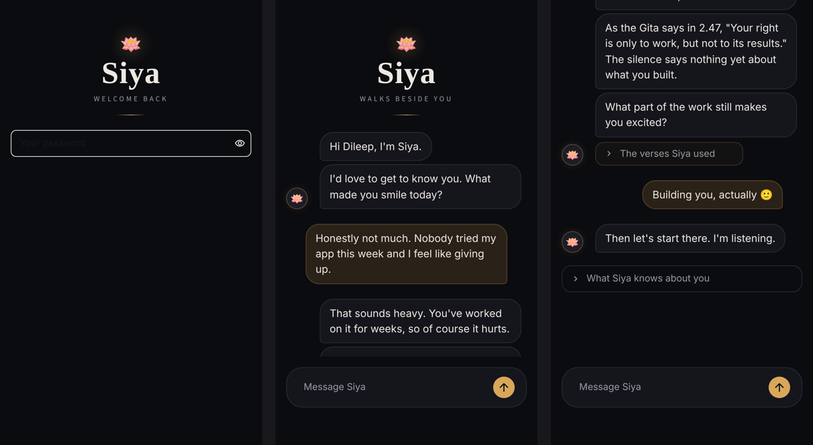

# ME.

**An AI that understands a person the way a close friend does, and is honest when it isn't sure.**

ME learns who you are from the choices you make, explains *why* it thinks so, and leaves every decision to you. It is built by one person, learning Python from zero, step by step and in the open.

> *"Ponder over this as a whole and do as you like."* (Bhagavad Gita 18.63)
> ME's guiding idea: like Krishna as Arjuna's charioteer, it walks beside you, helps you see, explains why, and leaves the bow in your hands.

---

## Two parts

### 1. The ME study: can an AI guess your choices?
A live web app ([itsme-ai.streamlit.app](https://itsme-ai.streamlit.app)) and a research experiment.

1. **A 5-minute game** of everyday scenes (a restaurant, a party, a delayed train). Players pick what they would really do, or say *"it depends"* and on what (mood, people, time, money).
2. **A secret prediction.** From the game, ME builds a profile (Big Five personality, Schwartz values, decision style, taste) and predicts the player's answers to 8 new questions *before* they answer.
3. **A blind test.** The player answers; only then are ME's guesses revealed, each with its reason (the "Why Chain").

### 2. Siya: a private AI friend and guide
A personal chat companion, currently used only by its builder as a long-term, one-person study.

- Talks like a friend texting: short, warm, starts the conversation, asks one thing at a time.
- Carries the wisdom of the **Bhagavad Gita** (701 verses) and the **Valmiki Ramayana**, and quotes **only the real text**, with chapter and verse you can open.
- Uses psychology the way a wise friend would: motivational interviewing, naming feelings, gently noticing thinking traps.
- Keeps her own notes about the person, only from what they said, with Big Five and value readings that always show the evidence and how sure she is.
- Never flatters, never claims to be human or divine, encourages real relationships, and points to real help in a crisis.

---

## Honest results so far (Nov 2026)

8 honest players, 64 predictions (2 speed-clickers left out):

| Method | Top pick right | Answer in top two |
|---|---|---|
| Random guessing | 25% | 50% |
| ME (personality only) | 33% | 61% |
| "Crowd": guess what most other players picked | 39% | 55% |
| ME with real Big Five averages from 592,359 people | **41%** | **69%** |

The crowd, not random guessing, is the honest bar to beat. With real population averages ME edged past it, but with only 8 players that may still be luck. More players are needed before any claim.

---

## How it's built

| Part | Tools |
|---|---|
| App | Python, Streamlit |
| Study data | Supabase (EU), row-level security, no names stored |
| AI | Gemini for the study's written portrait; Claude (Sonnet and Haiku) for Siya, with Gemini as fallback |
| Prediction | Multinomial logit (McFadden), Bayesian shrinkage, says-vs-does gaps |
| Population norms | IPIP-FFM open dataset, 592,359 cleaned responses |

Key files: `app.py` (study app) · `game.py`, `scenes.json` (the game) · `person.py`, `predict.py` (profile and predictions) · `analyze.py` (study results) · `me_private.py`, `siya_ai.py`, `gita.py`, `ramayana.py` (Siya).

## Research it stands on

Park et al. 2024 (generative agents of 1,000 people) · Gosling et al. 2003 (TIPI) · Schwartz 1992 (values) · Reynolds & Gutman 1988 (laddering) · McDaniel et al. 2007 (situational judgement) · Villar et al. 2013 (progress bars) · Miller & Rollnick (motivational interviewing) · Lieberman et al. 2007 (affect labelling).

## Privacy

No names are stored in the study, players get a random code, and data is deleted by 31 March 2027. Siya's memory lives in a separate, private database. No keys, study data or personal conversations are in this repository.

## Status and next steps

Target: a working prototype by **14 February 2027**.

- [x] Game, profile, blind prediction test, live study app
- [x] Real population averages, honest analysis against the crowd
- [x] Siya: private companion with the Gita, the Ramayana and a psychology layer
- [ ] 20+ study players, then Gate 2: does ME beat the crowd?
- [ ] Learn the game's weights from real data
- [ ] Siya: voice, and a small invited circle of testers

---

*Built by [Dileep](https://github.com/sagadileep). Feedback and ideas are welcome via GitHub issues.*
